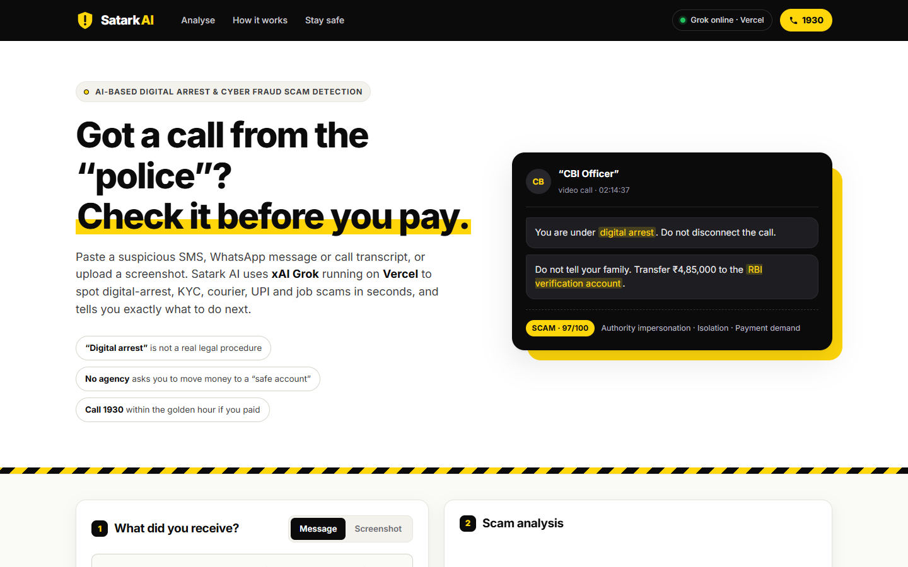

# Satark AI: Digital Arrest & Cyber Fraud Scam Detector

**AI-Based Digital Arrest & Cyber Fraud Scam Detection System**, built with the **xAI Grok API** and deployed on **Vercel**.

**Live:** https://satark-ai-murex.vercel.app

Paste a suspicious SMS, WhatsApp message or call transcript, or upload a screenshot. Satark AI returns:

- a verdict (**Scam / Suspicious / Likely safe**) and a **risk score from 0 to 100**
- the **scam category** (digital arrest, courier/parcel, KYC, UPI, job/task, investment, and more)
- **red flags quoted from the message**, each tagged with the tactic it uses
- **what to do now / what NOT to do**, in English, Hindi or Kannada
- the **1930 / cybercrime.gov.in / Sanchar Saathi** reporting links and a one-click complaint draft



## Architecture


| Layer | What it does |
|---|---|
| **Front end** (`public/`) | White, black and yellow dashboard served from the **Vercel Edge Network**. Text and screenshot input (drag, drop or paste), language choice, demo examples |
| **Vercel Function** (`api/index.js` → `server.js`) | HTTPS API `POST /api/analyze` in region **bom1 (Mumbai)**: validation, rate limiting, security headers, structured JSON logs |
| **Layer 1: rule engine** (`src/rules.js`) | Instant Indian scam-pattern check, indicator extraction (phone, UPI, URL, amount, account), offline fallback |
| **Layer 2: Grok** (`src/grok.js`) | Text + screenshot analysis (vision) with a system prompt and a **strict JSON schema** (structured outputs), plus model fallback |
| **Environment variables** | `XAI_API_KEY` is stored encrypted (sensitive) in Vercel and read by the function at runtime |

### Cloud and AI tools

| Service | Category | What it does for Satark AI |
|---|---|---|
| **xAI Grok API** (`grok-4.20-0309-non-reasoning`, fallback `grok-4.3`) | AI model (LLM + vision) | Reads the message and screenshot and returns a structured verdict with quoted evidence in EN / HI / KN |
| **Grok structured outputs** | AI feature | `response_format: json_schema` (strict) forces fixed fields and allowed values |
| **Vercel Functions** | Serverless compute | Runs the Node.js 22 API in Mumbai (`bom1`); scales automatically; 60 s limit |
| **Vercel Edge Network** | CDN / hosting | Serves the dashboard over HTTPS with security headers (CSP, X-Frame-Options) |
| **Vercel Environment Variables** | Security | Keeps `XAI_API_KEY` encrypted and out of the code |
| **Vercel CLI + GitHub** | CI / deploy | Version control and one-command production deploys (`vercel deploy --prod`) |
| **Vercel Runtime Logs** | Observability | Structured JSON logs (request ID, verdict, latency, engine) |

The app has **no npm dependencies**. It uses only Node.js built-ins and calls the xAI REST API with `fetch`.

## Run locally

Requires Node.js 20 or later.

```bash
# 1. Create an API key at https://console.x.ai (API Keys)
cp .env.example .env          # then paste your key into .env
# 2. Start
npm start                     # http://localhost:8080
# Use another port if 8080 is busy:
#   PowerShell: $env:PORT=3000; npm start
# 3. Tests (19 tests)
npm test
```

Without a key the app still works and uses the offline rule engine. The header shows the current mode.

## Deploy to Vercel

Needs the Vercel CLI: `npm i -g vercel`, then `vercel login`.

```powershell
# Windows
.\deploy\deploy.ps1 -XaiKey <YOUR_XAI_API_KEY>
```

```bash
# macOS / Linux / Git Bash
bash deploy/deploy.sh <YOUR_XAI_API_KEY>
```

The script runs the tests, links the folder to the Vercel project `satark-ai`, stores the key as an encrypted production environment variable, and runs `vercel deploy --prod`. The settings live in [`vercel.json`](vercel.json): static files from `public/`, every `/api/*` request rewritten to `api/index.js`, region `bom1`, 60 s function limit and security headers.

To confirm the deploy worked, open `https://<url>/api/health`. It should show `"aiConfigured": true` and `"platform": "vercel"`.

## API

`POST /api/analyze`

```json
{ "text": "This is Inspector Sharma, Mumbai Cyber Crime...", "image": { "mimeType": "image/jpeg", "data": "<base64>" }, "language": "en" }
```

Images must be PNG or JPG; the browser converts and compresses screenshots to stay under Vercel's 4.5 MB request limit.

Response (trimmed):

```json
{
  "engine": "grok", "model": "grok-4.20-0309-non-reasoning", "latencyMs": 6394,
  "analysis": {
    "verdict": "SCAM", "risk_score": 95, "scam_category": "DIGITAL_ARREST",
    "impersonated_entity": "Mumbai Police / CBI / RBI",
    "red_flags": [{ "evidence": "You are now under digital arrest", "explanation": "...", "tactic": "FEAR_THREAT" }],
    "recommended_actions": ["..."], "do_not": ["..."]
  },
  "rule_check": { "score": 100, "verdict": "SCAM" },
  "indicators": { "upi_ids": [], "bank_accounts": ["A/c No: 50100234567812"] },
  "helplines": [{ "value": "1930" }]
}
```

Other endpoints: `GET /api/health`, `GET /api/samples`, `GET /api/stats`.

## Results on the live deployment

All 8 demo messages, sent to the live Vercel deployment:

| Demo message | Expected | Grok | Rule engine only |
|---|---|---|---|
| Digital arrest video call | Scam | 95 – Scam (Digital arrest) | 100 – Scam |
| Courier parcel with drugs (IVR) | Scam | 85 – Scam (Courier / parcel) | 54 – Suspicious |
| Bank KYC block SMS | Scam | 85 – Scam (KYC / bank) | 46 – Suspicious |
| Electricity disconnection SMS | Scam | 75 – Scam (Utility bill) | 50 – Suspicious |
| Part-time job / task scam | Scam | 85 – Scam (Job / task) | 36 – Suspicious |
| UPI "sent by mistake" | Scam | 85 – Scam (UPI fraud) | 44 – Suspicious |
| Genuine delivery update | Likely safe | 10 – Likely safe | 0 – Likely safe |
| Normal family message | Likely safe | 5 – Likely safe | 0 – Likely safe |

## Project structure

```
api/index.js         Vercel serverless function (entry point for /api/*)
server.js            Request handler + local HTTP server
src/grok.js          xAI Grok client: prompt, JSON schema, validation, model fallback
src/rules.js         Rule engine + indicator extraction (Layer 1 / fallback)
src/samples.js       Demo messages (fictitious)
src/constants.js     Categories, tactics, helplines
public/              Dashboard UI (HTML/CSS/JS)
tests/               node:test suites
deploy/              Vercel deploy scripts (PowerShell + bash)
docs/                Architecture diagram, screenshots, CAT-03 report, demo script
vercel.json          Vercel config: routes, region, function limits, headers
```

## Disclaimer

Satark AI is an awareness and decision-support tool. It does not replace the police, your bank or the **1930** helpline.
