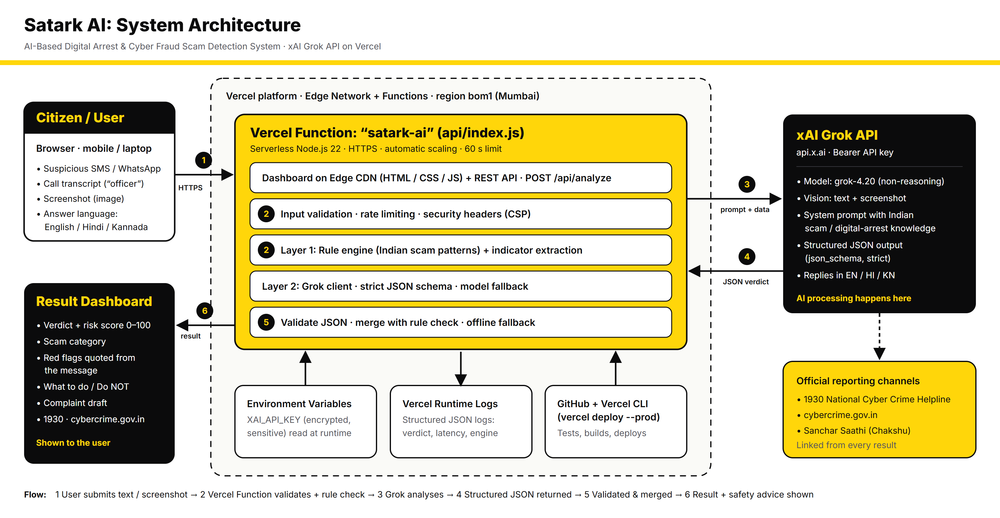

# Satark AI: Digital Arrest & Cyber Fraud Scam Detector

**AI-Based Digital Arrest & Cyber Fraud Scam Detection System**, built with the **Google Gemini API (Google AI Studio)** and deployed on **Google Cloud Run**.

Paste a suspicious SMS, WhatsApp message or call transcript, or upload a screenshot. Satark AI returns:

- a verdict (**Scam / Suspicious / Likely safe**) and a **risk score from 0 to 100**
- the **scam category** (digital arrest, courier/parcel, KYC, UPI, job/task, investment, and more)
- **red flags quoted from the message**, each tagged with the tactic it uses
- **what to do now / what NOT to do**, in English, Hindi or Kannada
- the **1930 / cybercrime.gov.in / Sanchar Saathi** reporting links and a one-click complaint draft

## Architecture



| Layer | What it does |
|---|---|
| **Front end** (`public/`) | White, black and yellow dashboard. Text and screenshot input (drag, drop or paste), language choice, demo examples |
| **Cloud Run service** (`server.js`) | HTTPS API `POST /api/analyze`, validation, rate limiting, security headers, structured logs |
| **Layer 1: rule engine** (`src/rules.js`) | Instant Indian scam-pattern check, indicator extraction (phone, UPI, URL, amount, account), offline fallback |
| **Layer 2: Gemini** (`src/gemini.js`) | Multimodal analysis with a system instruction and a **structured JSON response schema**, plus model fallback |
| **Secret Manager** | Holds `GEMINI_API_KEY`, which is injected into Cloud Run at runtime |

The app has **no npm dependencies**. It uses only Node.js built-ins and calls the Gemini REST API with `fetch`.

## Run locally

Requires Node.js 20 or later.

```bash
# 1. Get a free API key: https://aistudio.google.com/apikey
cp .env.example .env          # then paste your key into .env
# 2. Start
npm start                     # http://localhost:8080
# Use another port if 8080 is busy:
#   PowerShell: $env:PORT=3000; npm start
# 3. Tests (15 tests)
npm test
```

Without a key the app still works and uses the offline rule engine. The header shows the current mode.

## Deploy to Google Cloud Run

### Option A: Google Cloud Shell (easiest, nothing to install)

1. Open https://console.cloud.google.com, create or select a project, and make sure **billing is enabled**. Normal use stays within the free tier.
2. Open **Cloud Shell** (the `>_` icon), click **⋮ → Upload**, and upload `satark-ai.zip`.
3. Run:
   ```bash
   unzip -o satark-ai.zip -d satark-ai && cd satark-ai
   bash deploy/deploy.sh <YOUR_PROJECT_ID> <YOUR_GEMINI_API_KEY>
   ```
4. Open the URL that the script prints, for example `https://satark-ai-xxxxx-el.a.run.app`.

### Option B: from Windows (needs the Google Cloud CLI)

```powershell
gcloud auth login
.\deploy\deploy.ps1 -ProjectId <YOUR_PROJECT_ID> -GeminiKey <YOUR_GEMINI_API_KEY>
```

The script enables the APIs, stores the key in **Secret Manager**, grants access, and runs:

```bash
gcloud run deploy satark-ai --source . --region asia-south1 --allow-unauthenticated \
  --set-secrets GEMINI_API_KEY=gemini-api-key:latest
```

To confirm the deploy worked, open `https://<url>/api/health`. It should show `"geminiConfigured": true`.

## API

`POST /api/analyze`

```json
{ "text": "This is Inspector Sharma, Mumbai Cyber Crime...", "image": { "mimeType": "image/jpeg", "data": "<base64>" }, "language": "en" }
```

Response (trimmed):

```json
{
  "engine": "gemini", "model": "gemini-3.8-flash",
  "analysis": {
    "verdict": "SCAM", "risk_score": 97, "scam_category": "DIGITAL_ARREST",
    "impersonated_entity": "Mumbai Police / CBI",
    "red_flags": [{ "evidence": "You are now under digital arrest", "explanation": "...", "tactic": "FEAR_THREAT" }],
    "recommended_actions": ["..."], "do_not": ["..."]
  },
  "rule_check": { "score": 100, "verdict": "SCAM" },
  "indicators": { "upi_ids": [], "bank_accounts": ["A/c No: 50100234567812"] },
  "helplines": [{ "value": "1930" }]
}
```

The example response above shows the format only. Real values come from Gemini.

Other endpoints: `GET /api/health`, `GET /api/samples`, `GET /api/stats`.

## Project structure

```
server.js            HTTP server (Cloud Run entry point)
src/gemini.js        Gemini API client, prompt, response schema, validation
src/rules.js         Rule engine + indicator extraction (Layer 1 / fallback)
src/samples.js       Demo messages (fictitious)
src/constants.js     Categories, tactics, helplines
public/              Dashboard UI (HTML/CSS/JS)
tests/               node:test suites
deploy/              Cloud Run deploy scripts (bash + PowerShell)
docs/                Architecture diagram, screenshots, CAT-03 report, demo script
Dockerfile           Container image for Cloud Run
```

## Disclaimer

Satark AI is an awareness and decision-support tool. It does not replace the police, your bank or the **1930** helpline.
